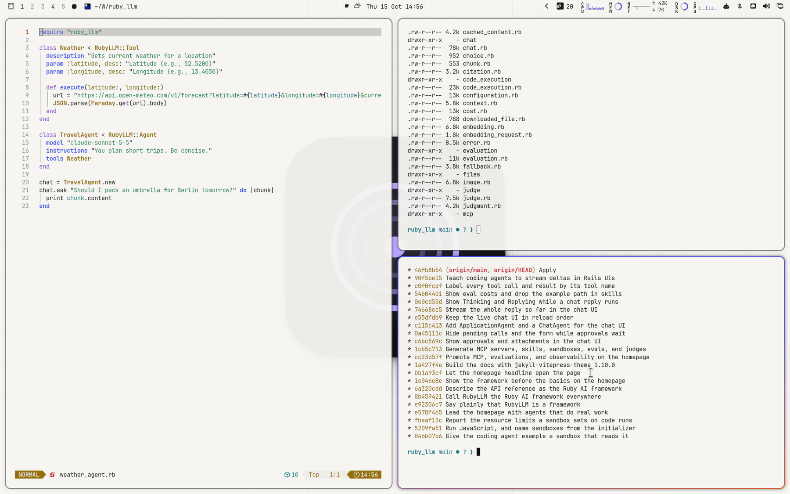

# Solco Light for Omarchy Quattro

A soft paper-white theme with Solco's violet, sampled from the getsolco.com design.



## Install

```bash
omarchy theme install https://github.com/crmne/omarchy-solco-light-theme.git
```

Activate it with:

```bash
omarchy theme set solco-light
```

## Architecture

This is a declarative Omarchy Quattro theme. It provides only:

- A semantic palette in `colors.toml`
- A GNOME icon theme choice in `icons.theme`
- Wallpapers in `backgrounds/`
- A selector preview in `preview.png`
- A boot unlock logo in `unlock.png`, with its selector preview in
  `preview-unlock.png`

Omarchy generates and applies the terminal, shell, Hyprland, editor, browser,
Obsidian, keyboard, and btop integrations from the semantic palette. The theme
contains no executable hooks, package installation, or application-specific
configuration files.

## Core colors

Sampled from the design tokens of [getsolco.com](https://getsolco.com).

- Accent: `#6a4fd8`
- Muted: `#7f8186`
- Background: `#f6f5f2`
- Surface: `#ffffff`
- Foreground: `#1b1b1d`
- Secondary text: `#4f5156`

## Wallpapers

Original wallpapers made for this theme from the brand's own artwork:

- `01-tile.jpg`: The Solco app icon centred with a soft warm shadow on the light beatgrid
- `02-lockup.jpg`: The logo with its name, centered
- `03-waveform.jpg`: The three-band waveform in the light UI's waveform tokens (blue lows, orange mids, light core) on a beatgrid with a red downbeat
- `04-field.jpg`: The launch poster's violet field, pale, with the mark's grooves at full scale in the centre and faint blue/orange corner glows

## Requirements

Omarchy 4 (Quattro) or newer.

## License

[MIT](LICENSE)
